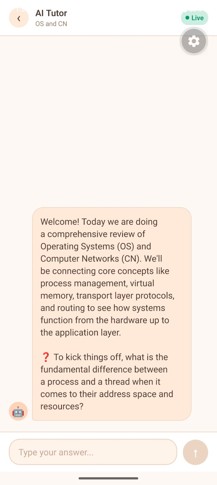
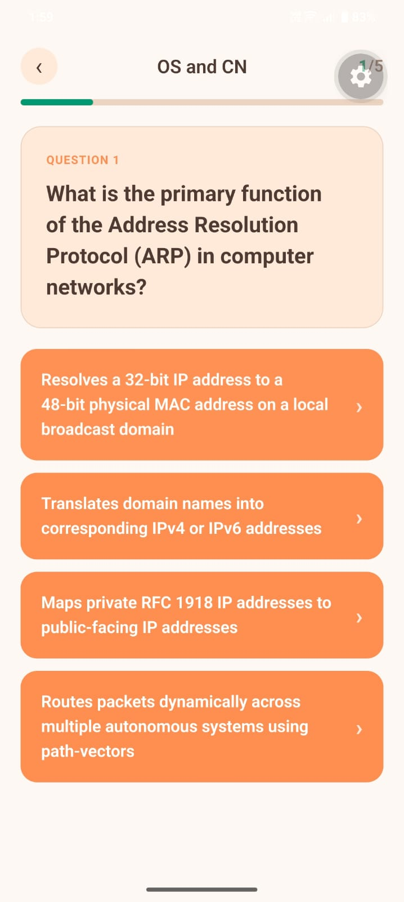
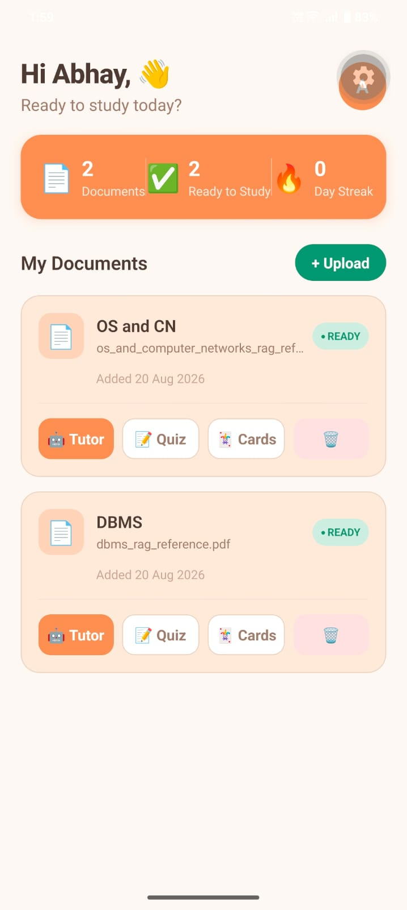

# AI Study Saathi 🧠📚

**AI Study Saathi** is an intelligent, RAG-powered study companion designed to make exam preparation smarter and more personalized.

It consists of a high-performance backend built with **Go (Golang), PostgreSQL, and pgvector**, alongside a modern mobile frontend built using **React Native and Expo**.

This repository contains both the **Frontend** and **Backend** source code.

---

## 🏗️ Backend Architecture & RAG Pipeline

The backend is built using Go, following a modular architecture that separates API handling, business logic, database operations, and AI integrations.

The Retrieval-Augmented Generation (RAG) pipeline processes uploaded study documents (PDF/TXT) through the following stages:

1. **Ingestion & Parsing:** Uploaded documents are parsed to extract their textual content.
2. **Chunking:** Extracted text is divided into smaller, contextually meaningful chunks with appropriate overlap to preserve semantic relationships.
3. **Vectorization:** Each chunk is converted into a vector embedding using Google's `text-embedding-004` model.
4. **Storage:** Embeddings, document metadata, and chunk information are stored in PostgreSQL using the `pgvector` extension.
5. **Retrieval:** User queries are embedded and matched against stored vectors using cosine similarity to retrieve the most relevant contextual chunks.
6. **AI Generation:** Retrieved context is supplied to Gemini to generate grounded, context-aware responses.

### Go Backend Design

- **Modular Architecture:** Separate packages for handlers, services, repositories, middleware, and AI integrations.
- **REST APIs:** HTTP endpoints for authentication, document management, quizzes, flashcards, and AI-powered study features.
- **Database Layer:** PostgreSQL with pgvector for persistent storage and semantic retrieval.
- **Concurrency:** Go goroutines and context-aware execution for handling independent background operations and AI workflows.
- **Configuration:** Environment-based configuration for database credentials, API keys, and application settings.

---

## 📱 Frontend & Core AI Features

The mobile application is developed using **React Native and Expo**, featuring a custom warm, organic design system.

### 1. Interactive AI Tutor (Powered by LangGraph)



Unlike a conventional stateless chatbot, the AI Tutor maintains conversational context and follows a stateful, cyclical workflow.

- **State Management:** Tracks `conversationHistory`, `currentConcept`, `questionCount`, and `weakAreas` throughout a learning session.
- **Dynamic Routing:** Based on the learner's response, the workflow dynamically determines the next action:
  - If the learner understands the concept → Moves to the next concept.
  - If the learner struggles → Routes to an explanation node that simplifies the concept.
- **UI Experience:** Real-time conversational interface with animated typing indicators and live session tracking.

---

### 2. Dynamic Quizzes (Powered by Gemini)



The quiz generator uses retrieved study material and structured AI responses to generate contextual questions rather than relying on generic prompts.

- **Structured Output:** Uses schema-based validation to ensure generated questions, answer options, and correct answers follow a consistent JSON structure.
- **Randomization:** Varies question selection and generation to provide different quiz experiences across attempts.
- **Contextual Generation:** Uses relevant document chunks retrieved through the RAG pipeline to generate topic-specific questions.
- **UI Experience:** Interactive pill-shaped options with animated press feedback and visual indicators for correct and incorrect answers.

---

### 3. Smart Flashcards (Powered by RAG)


The flashcard generator uses retrieved vector context to generate study cards grounded in the learner's uploaded materials.

- Automatically generates contextual questions, answers, and hints.
- Maintains source-document references to improve traceability.
- Uses retrieved document chunks to ensure flashcards remain relevant to the learner's syllabus.
- **UI Experience:** Realistic 180-degree card-flip animation using React Native's `Animated.View` and 3D interpolation (`rotateY`).

---

### 4. Smart Dashboard & Document Processing



The dashboard acts as the central hub for managing study materials and tracking learning progress.

- **Asynchronous Processing:** Documents are processed in the background, with statuses transitioning from `PROCESSING` to `READY` after extraction, chunking, and embedding.
- **Study Management:** Provides access to uploaded documents, quizzes, flashcards, and AI-powered learning tools.
- **UI Experience:** Responsive dashboard built with `SafeAreaView` and `FlatList`, displaying user statistics, document status badges, and quick action triggers.

---

## 🚀 Getting Started (Local Development)

### Prerequisites

- Go (version specified in `go.mod`)
- PostgreSQL with the `pgvector` extension
- Google Gemini API Key
- Node.js and npm
- Expo CLI / Expo Go

### 1. Backend Setup (Go)

Navigate to the backend directory:

```bash
cd backend
```

Copy the example environment file:

```bash
cp .env.example .env
```

Configure your environment variables:

```env
PORT=5001
DATABASE_URL=your_postgresql_connection_string
GEMINI_API_KEY=your_gemini_api_key
```

Download Go dependencies:

```bash
go mod download
```

Run database migrations using the migration tool configured in the project.

Start the backend:

```bash
go run .
```

The backend will be available at:

```text
http://localhost:5001
```

### 2. Frontend Setup (React Native + Expo)

Navigate to the frontend directory:

```bash
cd frontend
```

Install dependencies:

```bash
npm install
```

Create a `.env` file in the frontend directory:

```env
EXPO_PUBLIC_API_URL=http://YOUR_LOCAL_IP:5001/api
```

Replace `YOUR_LOCAL_IP` with your computer's local IPv4 address when testing on a physical device.

Start the Expo development server:

```bash
npx expo start
```

Scan the QR code using Expo Go on your Android or iOS device.

---

## ☁️ Deployment

The Go backend can be deployed as a Web Service on **Render**.

1. Connect the backend GitHub repository to Render.
2. Select Go as the runtime.
3. Configure the Go build and start commands.
4. Add database credentials and API keys through Render environment variables.
5. Configure the server to listen on the port provided by the `PORT` environment variable.
6. Deploy the application and obtain its public URL.

Once deployed, configure the frontend's `EXPO_PUBLIC_API_URL` with the public backend URL.

---

## 🛠️ Tech Stack

| Layer | Technologies |
|---|---|
| Backend | Go (Golang), REST APIs |
| Frontend | React Native, Expo |
| Database | PostgreSQL, pgvector |
| AI / LLM | Google Gemini |
| AI Workflows | LangGraph |
| RAG | Embeddings, Vector Search, Cosine Similarity |
| Mobile UI | React Native Animated API |
| Deployment | Render |
| Version Control | Git, GitHub |

---

**Built with ❤️ to make learning smarter, more personalized, and accessible.**